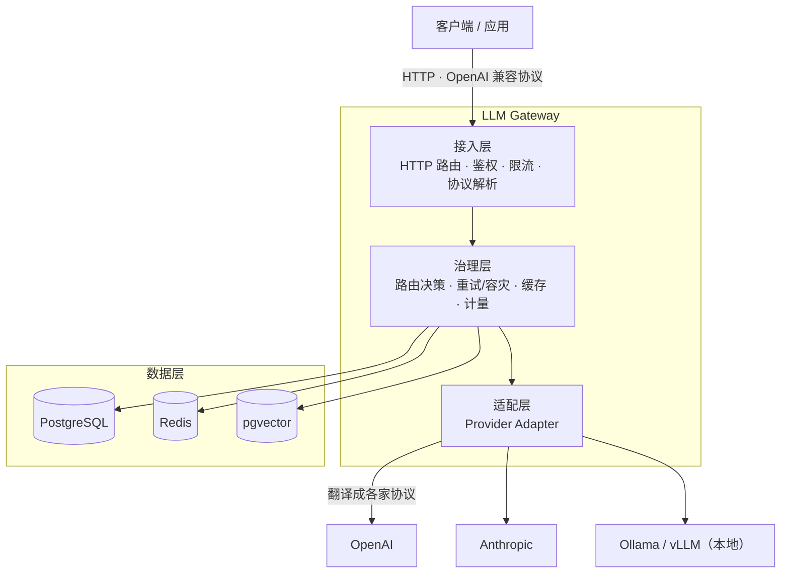

# LLM Gateway

一个基于 Go 实现的统一 LLM 服务网关。应用只需对接网关，由网关负责把请求路由到 OpenAI、Anthropic、本地模型等任意供应商，并统一处理鉴权、限流、容灾、流式转发、成本计量、缓存与安全。

## 特性

> 本项目按章节逐步实现，`[x]` 为已完成，`[ ]` 为规划中。

- [x] 项目骨架：配置加载、日志、优雅退出
- [x] 统一协议模型（OpenAI 兼容）
- [x] Provider 接口 + OpenAI 适配器
- [ ] 多供应商路由 / 负载均衡 / 故障转移
- [ ] 流式响应（SSE）
- [ ] 鉴权与多租户
- [ ] 限流与配额
- [ ] 可观测性（日志 / 指标 / 链路）
- [ ] 成本计量与账单
- [ ] 缓存（精确 + 语义）
- [ ] 安全防护（注入 / PII 脱敏）
- [ ] 模型与 Prompt 治理
- [ ] Agent 工具调用 / RAG

## 架构



## 快速开始

### 依赖

- Go 1.21+
- 一个 OpenAI 兼容的供应商 Key（当前配置示例为 DeepSeek）

### 运行

```bash
# 安装依赖
go mod tidy

# 修改配置
# 编辑 configs/config.toml，填入真实的 api_key

# 启动
go run ./cmd/server

# 验证健康检查
curl localhost:8080/healthz
```

### 优雅退出

服务监听 `SIGINT` / `SIGTERM`，收到信号后停止接收新请求，给在途请求 5 秒宽限期后退出。

## 目录结构

```
llmgw/
├── cmd/
│   └── server/           # 程序入口，只做装配
├── internal/
│   ├── app/              # 应用装配与生命周期
│   ├── api/              # 接入层：HTTP handler + 统一响应封装
│   ├── gateway/          # 治理层（规划）
│   ├── provider/         # 适配层：Provider 接口 + OpenAI 实现
│   ├── protocol/         # 统一协议模型（OpenAI 兼容）
│   ├── config/           # 配置加载
│   ├── log/              # 日志初始化
│   └── store/            # 数据层（规划）
├── configs/
│   └── config.toml       # 配置文件
└── go.mod
```

## 技术栈

| 关注点 | 选型 |
|---|---|
| HTTP 框架 | chi |
| 配置 | viper（TOML） |
| 日志 | slog |
| 存储 | PostgreSQL + Redis（规划） |
| 向量库 | pgvector（规划） |

## 配置说明

配置文件为 `configs/config.toml`，也可通过环境变量 `CONFIGFILE` 指定其他路径：

- `server.addr`：HTTP 监听地址
- `log.level`：日志级别（debug / info / warn / error）
- `openai.base_url`：OpenAI 兼容供应商地址
- `openai.api_key`：供应商 API Key
- `openai.timeout`：上游请求超时

## 相关文档

- 分章节学习路线见 [LLM-Gateway-教程.md](./LLM-Gateway-教程.md)
